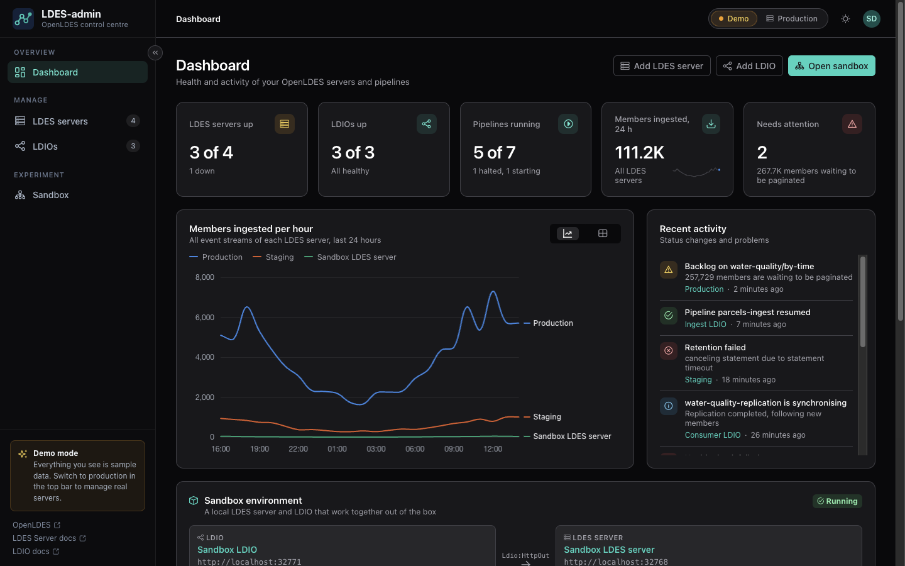
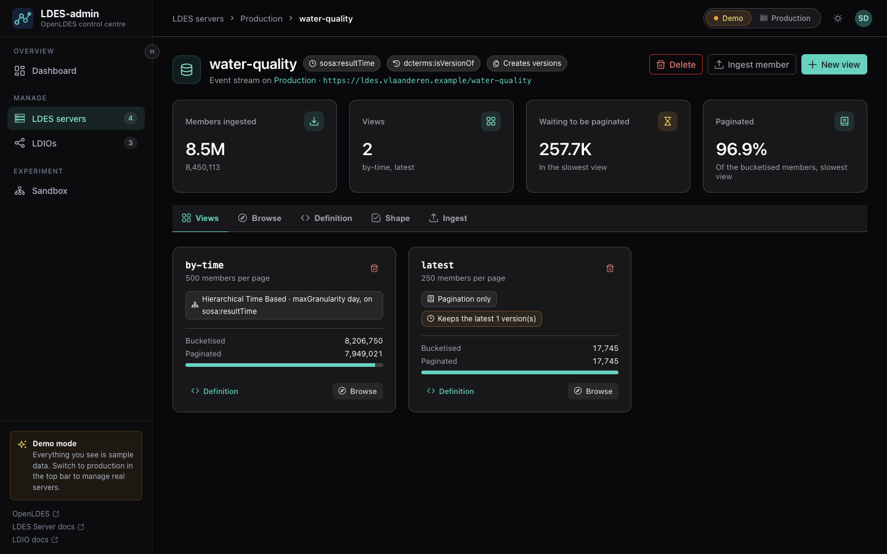
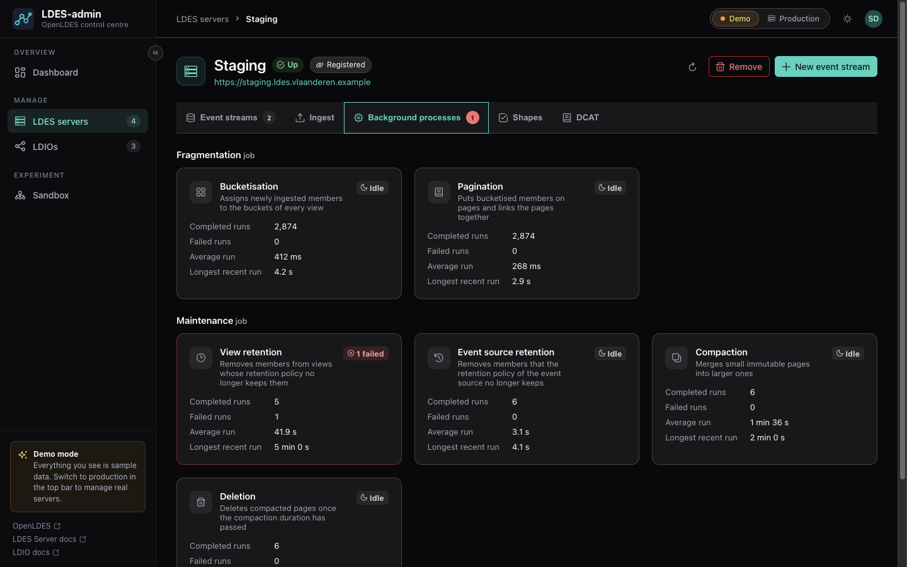
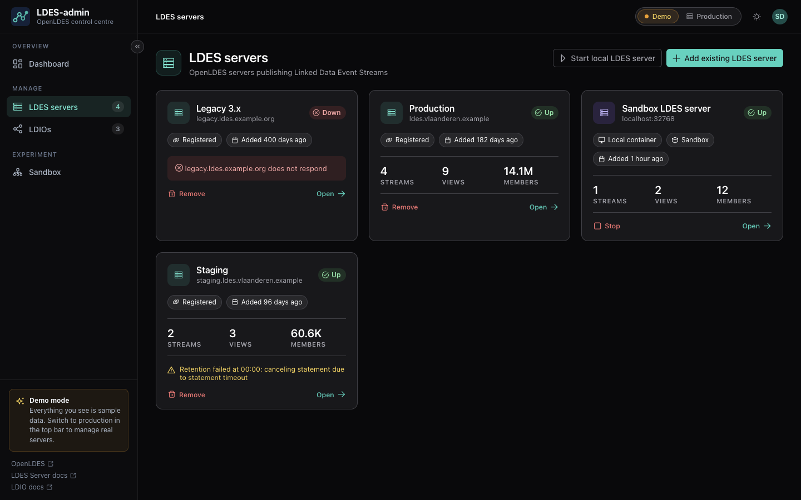
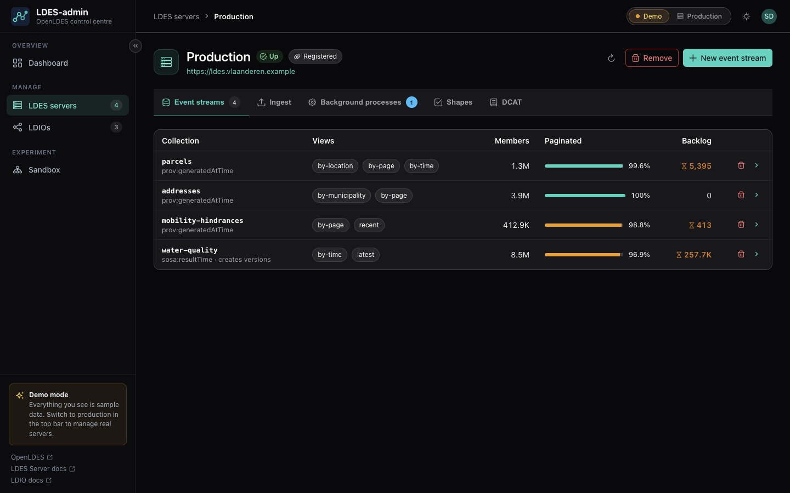
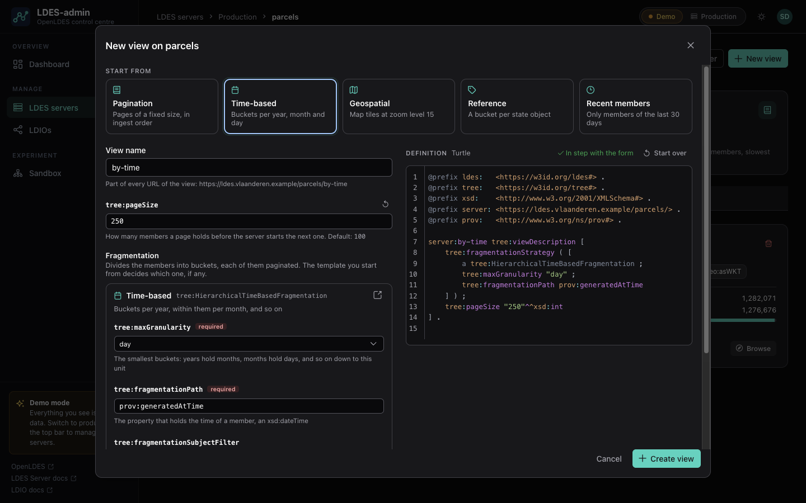
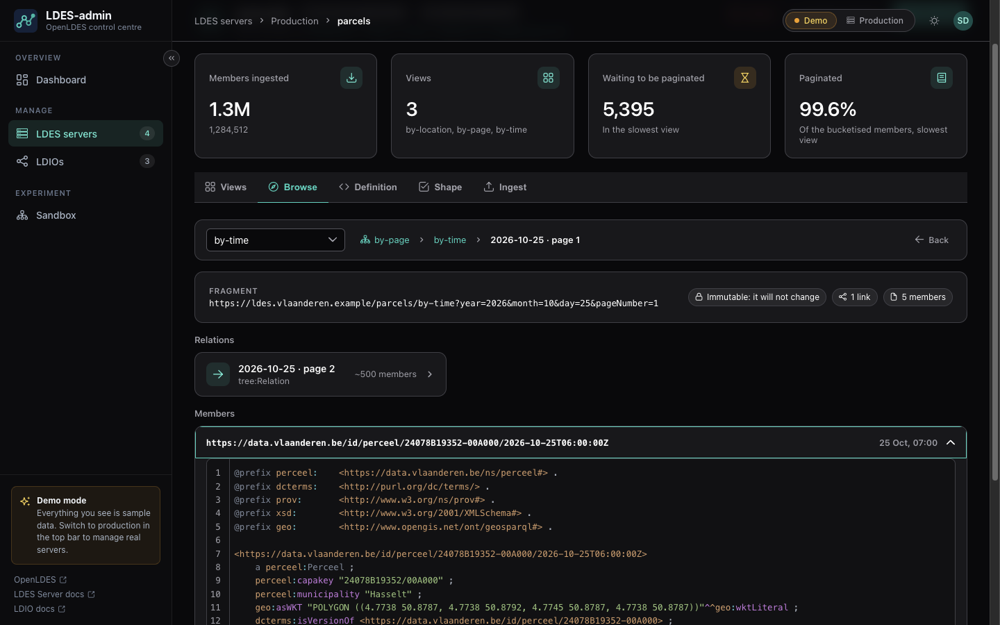
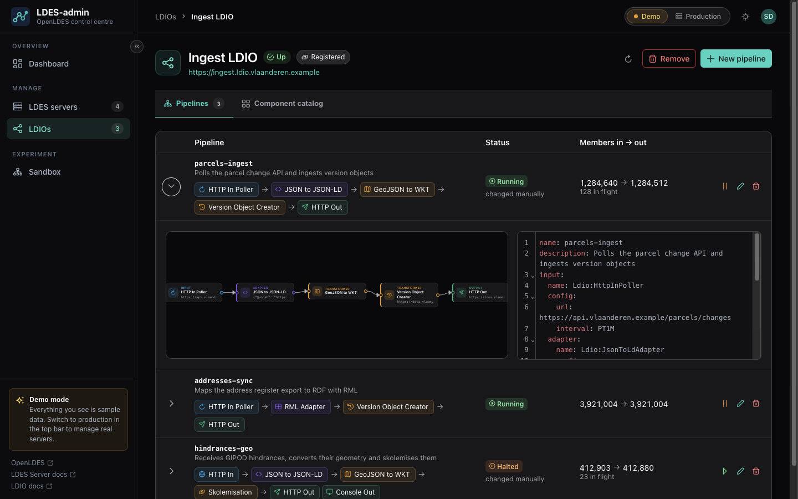
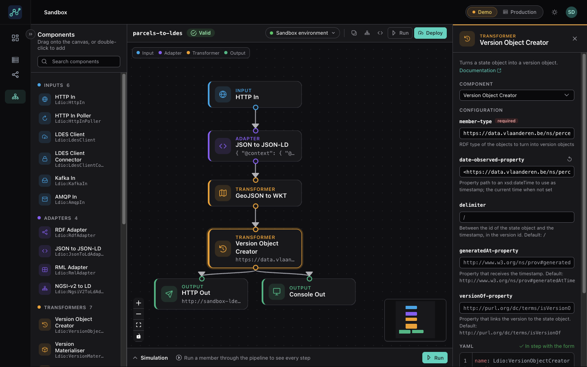
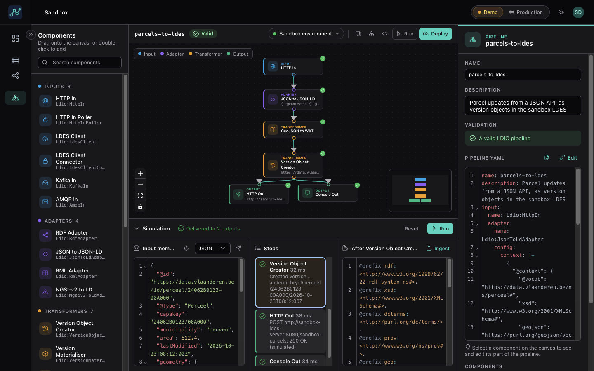

# LDES-admin

Administration, monitoring and sandboxing for [OpenLDES](https://openldes.org/) servers and Linked
Data Interaction Orchestrator (LDIO) pipelines.

[](docs/screenshots/dashboard.png)

## Features

### Monitor

* **Dashboard**: which LDES servers and LDIOs are up, how many pipelines run, the members ingested
  per hour over the last 24 hours, what needs attention, and a feed of recent activity.
* **Health checks**: every instance is checked every minute; LDES-admin records when one goes down
  and when it comes back.
* **Event stream statistics**: members ingested, bucketised and paginated per view, and the backlog
  still waiting to be paginated.
* **Background processes**: the fragmentation and maintenance jobs of a server (bucketisation,
  pagination, retention, compaction, deletion) with their runs, failures and durations, refreshed
  every 2 seconds (or as often as you choose).

| [](docs/screenshots/event-stream.png) | [](docs/screenshots/background-processes.png) |
|:---:|:---:|
| Views of an event stream, and how far they are paginated | Background processes, with a failed retention run |

### Manage LDES servers

* **Add** a server that runs elsewhere by its URL, or **start a local one** in Docker with one click.
* **Event streams and views**: create them in a form and as Turtle side by side, validated the way
  the server validates them. Templates for pagination, time-based, geospatial and reference
  fragmentation, and retention policies.
* **Shapes and DCAT**: edit the SHACL shape of an event stream and the DCAT catalog of the server,
  and see the catalog it publishes.
* **Browse** a view page by page: follow its relations and read its members.
* **Ingest** members directly on an event stream, in Turtle, JSON-LD, N-Quads or N-Triples.

| [](docs/screenshots/ldes-servers.png) | [](docs/screenshots/ldes-server.png) |
|:---:|:---:|
| LDES servers, registered and local | Event streams with their statistics |
| [](docs/screenshots/create-view.png) | [](docs/screenshots/fragment-browser.png) |
| Creating a view: form and Turtle stay in step | Browsing the pages and members of a view |

### Manage LDIOs

* **Add** an LDIO that runs elsewhere, or **start a local one** in Docker.
* **Pipelines**: their status, members in and out and the progress of LDES clients. Halt, resume,
  edit and delete them.
* **Component catalog**: the inputs, adapters, transformers and outputs an LDIO has installed.

[](docs/screenshots/ldio.png)

### Experiment in the sandbox

* **Design** a pipeline by dragging components onto a canvas, or start from a template. Configure
  every LDIO component in a form or as YAML, validated as you type.
* **Simulate**: run a member through the pipeline in the browser and see what each step makes of
  it.
* **Deploy** the pipeline to an LDIO, or start the **sandbox environment**: a local LDES server and
  LDIO in Docker that work together out of the box.

| [](docs/screenshots/sandbox.png) | [](docs/screenshots/simulation.png) |
|:---:|:---:|
| Designing a pipeline, with a form for every component | Running a member through the pipeline |

### Start from a demo

Two complete examples, each an event stream with the views `by-page` and `by-time` and the LDIO
pipeline that feeds it:

* **Sensor observations**, modelled with SOSA/SSN, with sample data sent through the pipeline;
* **Parking occupancy** of the car parks of Ghent, polled live from the open data of the city and
  mapped to Mobivoc, after the
  [OpenLDES onboarding example](https://github.com/OpenLDES/Onboarding-Example/tree/main/advanced-conversion).

Pick them when starting a local LDES server or LDIO, or start a new event stream from one.
Ingesting in their event streams starts from a member that fits, in the format of your choice.

### Try it without servers

**Demo mode** runs on sample data in the browser, to explore LDES-admin without any server;
**production mode** manages real LDES servers and LDIOs. Light and dark themes included.

## Documentation

* [The documentation site](https://openldes.github.io/LDES-admin/) – installing LDES-admin,
  monitoring, LDES servers, LDIO and the sandbox
* [analysis/README.md](analysis/README.md) – what LDES-admin does
* [analysis/architecture.md](analysis/architecture.md) – how it is built

The documentation site is a [Jekyll](https://jekyllrb.com/) 4 site in `docs/`, published to GitHub
Pages by workflow 5 (see [below](#continuous-integration-and-releases)). It reuses the screenshots
in `docs/screenshots/`. To preview it, with Ruby installed:

```shell
cd docs
bundle install
bundle exec jekyll serve   # http://localhost:4000
```

## Project layout

| Directory     | What                                                                                                                        |
|---------------|-----------------------------------------------------------------------------------------------------------------------------|
| `model`       | Domain model (plain Java)                                                                                                   |
| `application` | Use cases, ports and services (plain Java)                                                                                  |
| `adapter`     | REST API, monitor, Postgres (JPA + Flyway), LDES server and LDIO clients, local Docker runtime                              |
| `frontend`    | Vue 3 + TypeScript + PrimeVue + Vue Flow frontend, in demo or production mode; Maven packages the build as static resources |
| `bootstrap`   | Spring Boot application, serving the API and the frontend                                                                   |

## Requirements

* JDK 25
* Docker, for the database during development, the integration tests and local LDES servers/LDIOs
* pnpm 9, only to run the frontend on its own (see [below](#2-backend-and-frontend-separately)).
  The frontend needs Node.js 22.12 or later (Vite 7); pnpm downloads and uses Node.js 24.21.0 for
  it automatically, whatever Node.js your shell runs (`use-node-version` in `frontend/.npmrc`).

## Running LDES-admin

There are two ways to run LDES-admin: as one application, built by Maven, or as a backend and a
frontend that run separately.

### 1. One application, from the Maven build

To use LDES-admin, or to work on the backend. Maven builds the frontend along with the backend, and
the Spring Boot application serves it. You need neither Node.js nor pnpm: Maven downloads Node.js
into `frontend/node/` and pnpm through corepack.

```shell
./mvnw install -DskipTests
./mvnw -pl bootstrap spring-boot:run
```

This starts Postgres from `compose.yaml`, and LDES-admin on <http://localhost:8080>: the frontend on
`/` and the API on `/api/v1`. In the IDE, run `TestLdesAdminApplication` (bootstrap test sources)
instead to get Postgres from Testcontainers.

The frontend is what the last Maven build packaged: a change to it shows after
`./mvnw -pl frontend install` and a restart. When you only change the backend,
`./mvnw install -Dfrontend.skip` skips building the frontend and keeps the one in `frontend/dist/`.

`./mvnw package` builds `bootstrap/target/ldes-admin-bootstrap-*.jar`, which holds the frontend
too; give it a database with `spring.datasource.*`.

### 2. Backend and frontend separately

To work on the frontend. Vite serves the frontend, with hot reloading: a change shows in the browser
as soon as you save it. The backend runs on its own, and Vite forwards the calls to its API.

Start the backend, without building the frontend:

```shell
./mvnw install -DskipTests -Dfrontend.skip
./mvnw -pl bootstrap spring-boot:run
```

Then, in another terminal, start the frontend with pnpm:

```shell
cd frontend
pnpm install
pnpm dev          # http://localhost:5173
```

Open the frontend on <http://localhost:5173>; <http://localhost:8080> still serves whatever the last
Maven build packaged. Vite proxies `/api` and `/actuator` to the backend on
<http://localhost:8080>. To use a backend elsewhere, set `LDES_ADMIN_BACKEND`:

```shell
LDES_ADMIN_BACKEND=https://ldes-admin.example.org pnpm dev
```

The frontend works without a backend too: it then starts in demo mode, on sample data.

## Demo and production mode

The switch in the top bar picks the mode, whichever way LDES-admin runs:

* **Demo** runs on sample data in the browser, to explore LDES-admin without any server.
* **Production** talks to the backend, which manages real LDES servers and LDIOs.

Without an earlier choice, the frontend starts in production mode when the backend answers, and in
demo mode otherwise.

## Tests and builds

With Maven, for the whole project:

```shell
./mvnw test     # unit, slice and architecture tests, and the frontend unit tests
./mvnw verify   # also the integration tests (Docker; pulls the LDES server and LDIO images)
```

With pnpm, for the frontend:

```shell
cd frontend
pnpm test         # unit tests (Jest)
pnpm test:e2e     # end-to-end tests (Cypress) against a production build
pnpm build        # type-check and build to dist/
```

## Configuration

Configuration is in `bootstrap/src/main/resources/application.yaml`: the Docker images for local
instances (`ldes-admin.local-runtime.*`), how often the instances are monitored
(`ldes-admin.monitor.*`), and `ldes-admin.security.enabled` to require a JWT.

## Sandbox

In production mode, *Start sandbox* (on the dashboard, or *Sandbox environment* in the sandbox)
starts a local LDES server and LDIO in Docker, on the machine running the backend. They work
together out of the box:

* the LDES server has an event stream `sandbox-parcels`, with a paginated view `by-page` and a
  time-based view `by-time`;
* the LDIO has a pipeline `sandbox-ingest` that receives members over HTTP and ingests them in
  `sandbox-parcels`;
* inside the sandbox, pipelines reach the event stream on
  `http://sandbox-ldes-server:8080/sandbox-parcels`, so pipelines designed in the sandbox can write
  to it (`Ldio:HttpOut`) and read from it (`Ldio:LdesClient`).

The first start pulls the Docker images, which takes a few minutes. The sandbox stops with *Stop*,
and with the backend.

## Docker image

The workflows below publish LDES-admin as a Docker image (`linux/amd64` and `linux/arm64`). It
needs Postgres, and the Docker socket of the host to start local LDES servers and LDIOs:

```shell
docker run -p 8080:8080 \
  -e SPRING_DATASOURCE_URL=jdbc:postgresql://<host>:5432/<database> \
  -e SPRING_DATASOURCE_USERNAME=<user> -e SPRING_DATASOURCE_PASSWORD=<password> \
  -v /var/run/docker.sock:/var/run/docker.sock --group-add <group of the socket> \
  <namespace>/ldes-admin:<version>
```

The container runs as a user without privileges: `--group-add` gives it access to the socket (the
group that owns `/var/run/docker.sock`; `0` on Docker Desktop). On Docker Desktop, also set
`TESTCONTAINERS_HOST_OVERRIDE=host.docker.internal`, so LDES-admin reaches the containers it starts.

## Continuous integration and releases

The GitHub workflows in `.github/workflows` follow the release flow of the
[OpenLDES server](https://github.com/OpenLDES/LDESServer/tree/main/.github): work happens on
`develop`, releases on `main`.

| Workflow                           | Runs on                                       | What it does                                                                                                                                                                                             |
|------------------------------------|-----------------------------------------------|----------------------------------------------------------------------------------------------------------------------------------------------------------------------------------------------------------|
| 1.a. Build & Test Project          | pull requests, or manually                    | `./mvnw verify` (with a SonarCloud analysis when enabled), the Cypress tests, and a Docker image that Trivy scans (results in the Security tab)                                                          |
| 2.a. Build & Deploy Project        | pushes to `develop` and `main`, or manually   | Builds and pushes the image: from `develop` to `ghcr.io/<owner>/<repository>:<version>-<timestamp>` (in lowercase) and `latest`; from `main` to Docker Hub, `<namespace>/ldes-admin:<version>`, and `latest` for a release |
| 3. Approve Snapshot                | publishing a GitHub release of `main`, or manually on `main` | Opens the pull request `ci/promote-snapshot`, which turns the snapshot version into the release version (`0.1.0-SNAPSHOT` becomes `0.1.0`)                                                  |
| 4. Prepare New Version for Project | manually, choosing a patch, minor or major bump | Releases `develop` with the Maven release plugin: tags the version and moves `develop` on to the next snapshot                                                                                          |
| 5. Build & Deploy Documentation    | pushes to `main` and pull requests that change `docs/`, or manually | Builds the documentation site with Jekyll; on `main`, publishes it to GitHub Pages                                                                                                  |

To release a version:

1. Merge the pull requests of the version into `develop`. Every merge publishes a snapshot image to
   the GitHub Container Registry.
2. Merge `develop` into `main` (a pull request). This publishes `<version>-SNAPSHOT` to Docker Hub.
3. Publish a GitHub release of `main`, with a tag `v<version>` (the Maven release plugin uses the
   bare version for its own tags). Workflow 3 opens a pull request that promotes the snapshot;
   merging it publishes `<version>` and `latest` to Docker Hub.
4. Run workflow 4 to move `develop` on to the next snapshot version.

Configure the repository under *Settings › Secrets and variables › Actions*:

| Variable              | Needed for                       | Value                                                              |
|-----------------------|----------------------------------|--------------------------------------------------------------------|
| `DOCKER_NAMESPACE`    | 2.a on `main`                    | The Docker Hub namespace (user or organisation) of the image       |
| `GIT_CONFIG_USERNAME` | 3                                | Author of the commit that promotes the version                     |
| `GIT_CONFIG_EMAIL`    | 3                                | E-mail address of that author                                      |
| `JAVA_DISTRIBUTION`   | all, optional                    | The JDK distribution for `actions/setup-java`; default `temurin`   |
| `JAVA_VERSION`        | all, optional                    | The JDK version; default `25`                                      |
| `RUBY_VERSION`        | 5, optional                      | The Ruby version that builds the documentation; default `4.0`      |
| `ANALYSE_PACKAGE`     | 1.a, 2.a, optional               | `true` to analyse the code with SonarCloud                         |
| `SONAR_ORGANIZATION`  | with `ANALYSE_PACKAGE`           | The SonarCloud organisation                                        |
| `SONAR_PROJECT_KEY`   | with `ANALYSE_PACKAGE`           | The SonarCloud project key                                         |

| Secret            | Needed for             | Value                                                                                                                                                                                  |
|-------------------|------------------------|----------------------------------------------------------------------------------------------------------------------------------------------------------------------------------------|
| `DOCKER_USER`     | 2.a on `main`          | A Docker Hub user that may push to the namespace                                                                                                                                       |
| `DOCKER_PASSWORD` | 2.a on `main`          | An access token of that user                                                                                                                                                           |
| `SSH_PRIVATE_KEY` | 4                      | The private key of a deploy key with write access, which pushes the release commits and tag (see [Setup with SSH](https://github.com/qcastel/github-actions-maven-release#setup-with-ssh)) |
| `SONAR_TOKEN`     | with `ANALYSE_PACKAGE` | A SonarCloud token                                                                                                                                                                     |

The workflows publish to the GitHub Container Registry with the token GitHub gives them. For
workflow 3, allow *GitHub Actions to create and approve pull requests* (*Settings › Actions ›
General › Workflow permissions*). When `develop` is protected, let the deploy key of workflow 4
push to it. For workflow 5, pick *GitHub Actions* as the source of GitHub Pages (*Settings › Pages*)
and, when the deployment is refused, allow `main` to deploy to the `github-pages` environment
(*Settings › Environments*).

## Usage of AI

This project was developed with the help of AI tools. These tools were used to assist in code
generation, documentation, and problem-solving. The developers reviewed and edited the AI-generated
content to ensure accuracy and quality.
