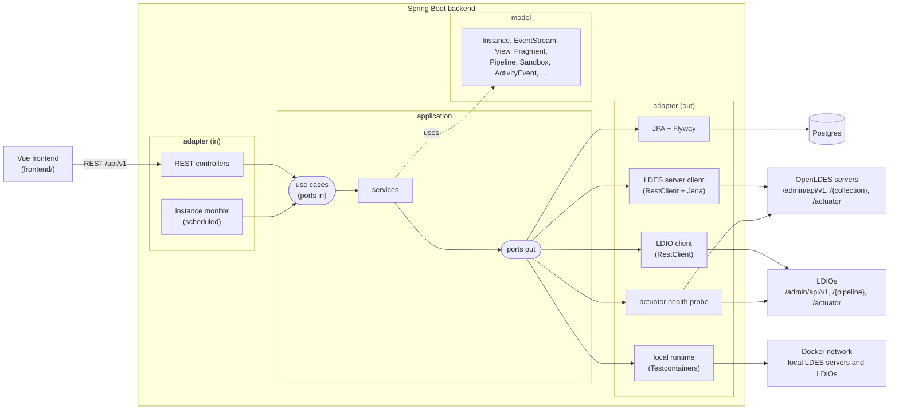

# LDES-admin architecture

LDES-admin monitors and manages OpenLDES servers and Linked Data Interaction Orchestrators (LDIO),
and offers a sandbox to design and try pipelines. See [README.md](README.md) for what it does; this
document describes how it is built.



## Hexagonal architecture

The backend follows the hexagonal architecture of
[Sven Woltmann's example](https://github.com/SvenWoltmann/hexagonal-architecture-java/tree/with-spring-boot):
every ring is a Maven module, so the compiler enforces that dependencies only point inwards.

| Module        | Contains                                                         | Depends on    | Frameworks                  |
|---------------|------------------------------------------------------------------|---------------|-----------------------------|
| `model`       | Domain model: records with their invariants and behaviour        | –             | none                        |
| `application` | Use cases (ports in), ports out, and the services implementing them | `model`     | none                        |
| `adapter`     | REST API, scheduler, JPA persistence, LDES server/LDIO clients, local runtime | `application` | Spring, Jena, Testcontainers |
| `bootstrap`   | Spring Boot application, wiring, security, scheduling, configuration | `adapter`  | Spring Boot                 |

`DependencyRuleTest` (ArchUnit, in `bootstrap`) additionally checks what the modules cannot:
adapters don't depend on each other, inbound adapters only use use cases (never services),
outbound adapters only implement ports, and `model`/`application` stay free of Spring, Jakarta,
Jackson, Jena and Testcontainers.

The application services are plain Java classes marked with `@ApplicationService` (a plain
annotation of the application ring). `ApplicationServiceConfig` in `bootstrap` turns them into
beans by classpath scanning, so the application ring needs no Spring dependency.

### Packages

```
org.openldes.ldesadmin
├── model
│   ├── instance     Instance (aggregate root), InstanceId, InstanceType, InstanceOrigin, InstanceHealth
│   ├── rdf          RdfDocument, RdfFormat
│   ├── ldes         EventStream, View, Fragment, Fragmentation, RetentionPolicy, DcatTarget, CatalogDescription,
│   │                StreamStatistics, BackgroundProcess
│   ├── ldio         Pipeline, InputDefinition, ComponentDefinition, DeployedPipeline, PipelineStatus, LdesClientStatus, …
│   ├── sandbox      Sandbox
│   ├── monitoring   ActivityEvent, IngestSample, ThroughputSeries
│   └── dashboard    DashboardOverview, LdesServerSummary, LdioSummary
├── application
│   ├── port.in      instance | ldes | ldio | sandbox | monitoring | dashboard   use case interfaces and their exceptions
│   ├── port.out     persistence | ldes | ldio | health | runtime | monitoring, RemoteInstanceException
│   └── service      instance | ldes | ldio | sandbox | monitoring | dashboard   one service per use case
├── adapter
│   ├── in.rest      instance | ldes | ldio | sandbox | monitoring | dashboard, RestExceptionHandler (RFC 9457)
│   ├── in.scheduling InstanceMonitorScheduler
│   └── out          persistence.jpa | ldes | ldio | health | runtime | http (shared HTTP helpers)
└── bootstrap        LdesAdminApplication, ApplicationServiceConfig, SchedulingConfig, SecurityConfig
```

## Domain model

* **Instance** – an LDES server or LDIO managed by LDES-admin. It is either *registered* (it runs
  somewhere; LDES-admin only knows its URL) or *local* (LDES-admin started it as a Docker container
  and stops it again). A local instance also has an *internal URL*, on which other local instances
  reach it (`http://sandbox-ldes-server:8080`); a local LDES server publishes its IRIs on it.
  `Instance.reachable` translates such an IRI to the URL LDES-admin can fetch, and
  `Instance.serves` tells whether a URL belongs to the instance at all. Any instance can be flagged
  as a *sandbox*.
* **EventStream / View / shape / DCAT** – the configuration of an LDES server. The admin API speaks
  RDF, so the definitions travel as `RdfDocument`s; the outbound adapter extracts the fields LDES-admin
  shows (collection, timestamp path, views, fragmentations, retention policies, page size). The
  `CatalogDescription` is the catalog of the server itself, as a blank node the server accepts back.
* **Fragment** – a page of a view as an LDES client sees it: its relations to other pages and its
  members.
* **Pipeline** – an LDIO pipeline: one input (with an optional adapter), a chain of transformers and
  one or more outputs, each a component name with its configuration. `DeployedPipeline` adds the
  status (`INIT`, `RUNNING`, `HALTED`, …); only running pipelines can be halted and only halted ones
  resumed.
* **Statistics** – members ingested, bucketised and paginated per stream and view (LDES server
  gauges), members in and out per pipeline (LDIO counters). The *backlog* of a stream is the number
  of members bucketised but not yet paginated in its slowest view. A **BackgroundProcess** is a step
  of the fragmentation or maintenance job of a server, from its Spring Batch metrics.
* **Sandbox** – the local LDES server *Sandbox LDES server* and LDIO *Sandbox LDIO*. Out of the box,
  the LDIO pipeline `sandbox-ingest` (`Ldio:HttpIn` + `Ldio:RdfAdapter` → `Ldio:HttpOut`) feeds the
  event stream `sandbox-parcels`, which has a paginated view (`by-page`) and a time-based one
  (`by-time`).
* **Monitoring** – an **ActivityEvent** records what happened to an instance: actions taken through
  LDES-admin and changes it noticed (down, up again). **IngestSample**s of the members every LDES
  server ingested so far give its **ThroughputSeries**, the members ingested per hour.

Instances, activity and ingest samples are the only state LDES-admin stores itself.

## Use cases and REST API

Every use case is exposed by a controller under `/api/v1`; errors are problem details (`404` for
unknown instances, pipelines and remote resources, `409` for duplicates and impossible status
changes, `400` for invalid input or requests a server rejected, `502` when an instance cannot be
reached, `503` when a local instance cannot be started).

| Use case                          | Endpoints                                                                       |
|-----------------------------------|---------------------------------------------------------------------------------|
| Register / find / unregister instances | `GET, POST /ldes-servers`, `GET, DELETE /ldes-servers/{id}` (same for `/ldios`) |
| Start a local instance            | `POST /ldes-servers/local`, `POST /ldios/local`                                  |
| Check health                      | `GET /{ldes-servers,ldios}/{id}/health`                                          |
| Sandbox                           | `GET, POST, DELETE /sandbox` (state, start and prepare, stop)                    |
| Event streams                     | `GET, POST /ldes-servers/{id}/eventstreams`, `GET, DELETE …/eventstreams/{collection}` |
| Views                             | `GET, POST …/eventstreams/{collection}/views`, `GET, DELETE …/views/{view}`      |
| Fragments                         | `GET …/views/{view}/fragment?url=` (the root of the view without `url`)          |
| Shapes                            | `GET, PUT …/eventstreams/{collection}/shape`                                    |
| DCAT                              | `GET /ldes-servers/{id}/dcat` (as published), `GET, PUT /ldes-servers/{id}/server-catalog`, `POST /dcat`, `PUT, DELETE …/dcat/{catalogId}`, `POST, PUT, DELETE` on `…/eventstreams/{collection}/dcat` and `…/views/{view}/dcat` |
| Ingest a member                   | `POST …/eventstreams/{collection}/members` (Turtle, JSON-LD, N-Quads, N-Triples) |
| Stream statistics, processes      | `GET /ldes-servers/{id}/statistics`, `GET /ldes-servers/{id}/processes`          |
| Pipelines                         | `GET, POST /ldios/{id}/pipelines`, `GET, PUT, DELETE …/pipelines/{name}`         |
| Halt / resume                     | `GET …/pipelines/{name}/status`, `POST …/{name}/halt`, `POST …/{name}/resume`    |
| Send to a pipeline                | `POST /ldios/{id}/pipelines/{name}/members` (any content type the adapter of the pipeline reads) |
| Component catalog, statistics     | `GET /ldios/{id}/catalog`, `GET /ldios/{id}/statistics`, `GET /ldios/{id}/ldes-clients` |
| Dashboard, activity               | `GET /dashboard`, `GET /dashboard/throughput`, `GET /activity?limit=`            |

LDIO has no update operation: updating a pipeline deletes it (waiting until LDIO has stopped it)
and creates it again.

Fetching a fragment goes through LDES-admin, so it only fetches URLs of the server itself
(`Instance.serves`): it does not become a proxy to anywhere else.

### Monitoring

`InstanceMonitorScheduler` (an inbound adapter) calls `MonitorInstancesUseCase` every
`ldes-admin.monitor.interval` (1 minute): it checks the health of every instance, records when one
goes down or comes back, and samples the members every healthy LDES server ingested. Samples are
kept 48 hours. On startup it removes the local instances whose container stopped with a previous
run of LDES-admin.

### Sandbox

`SandboxService` starts the missing sandbox instances side by side (virtual threads), through the
same use case as any local instance, and then prepares them, unless that was done before: the
`sandbox-parcels` event stream with its views, and the `sandbox-ingest` pipeline sending to the
event stream on the internal URL of the server. Starting again is harmless; it also redeploys the
pipeline when it points to another server than the current one. Stopping unregisters both, which
stops their containers.

## Outbound adapters

| Port                     | Adapter                       | Talks to                                                         |
|--------------------------|-------------------------------|------------------------------------------------------------------|
| `InstanceRepository`, `ActivityLog`, `IngestSampleRepository` | `JpaInstanceRepository`, `JpaActivityLog`, `JpaIngestSampleRepository` | Postgres; the schema is owned by Flyway (`adapter/src/main/resources/db/migration`), Hibernate only validates it |
| `LdesServerClient`       | `RestLdesServerClient`        | `/admin/api/v1/…` (Turtle, parsed with Apache Jena), `POST /{collection}`, the fetch API (pages, with `Cache-Control: immutable`), `/actuator/prometheus` (`ldes_server_*_members_count`, `spring_batch_step_*`) |
| `LdioClient`             | `RestLdioClient`              | `/admin/api/v1/pipeline…`, `/admin/api/v1/pipeline/ldes-client`, `/admin/api/v1/catalog`, `POST /{pipeline}`, `/actuator/prometheus` (`ldio_data_in_total`, `ldio_data_out_total`) |
| `InstanceHealthProbe`    | `ActuatorHealthProbe`         | `/actuator/health`, falling back to the admin API                 |
| `LocalInstanceRuntime`   | `DockerLocalInstanceRuntime`  | Docker, through the Testcontainers API: `openldes/ldes-server` with its own Postgres, or `openldes/ldi-orchestrator` |

HTTP errors are translated into a `RemoteInstanceException` with a reason (`NOT_FOUND`, `REJECTED`,
`UNAVAILABLE`), so no Spring type leaks into the application ring.

### Local instances

All local instances join one Docker network, under a host name derived from their name
("Sandbox LDES server" becomes `sandbox-ldes-server`, with a suffix when it is taken). A local LDES
server gets `LDESSERVER_HOSTNAME=http://<host name>:8080`, so it publishes absolute IRIs that other
local instances can follow: an LDIO `Ldio:LdesClient` cannot follow relative ones. It fragments new
members every 5 seconds (`ldes-admin.local-runtime.fragmentation-cron`) instead of every 30, so
experiments show results quickly. LDES-admin reaches the containers on their mapped ports and
translates the internal IRIs (`Instance.reachable`).

Assumptions worth knowing:

* An LDES server is reached on one base URL for its admin, ingest and fetch endpoints and its
  actuator (the default single-port setup). Statistics and background processes need
  `/actuator/prometheus` to be exposed.
* Local instances are for experimenting: Testcontainers removes them when LDES-admin stops, and
  LDES-admin removes their registrations on the next start.
* Starting a local instance, or the sandbox, blocks the request until the containers are healthy
  (the first time includes pulling the images).

## Security

`SecurityConfig` leaves the API open by default, for local use. With
`ldes-admin.security.enabled=true` the API becomes an OAuth2 resource server that requires a JWT
(configure `spring.security.oauth2.resourceserver.jwt.issuer-uri`); `/actuator/health` stays public.

## Testing

| Level                    | Where                          | What                                                                  |
|--------------------------|--------------------------------|-----------------------------------------------------------------------|
| Unit                     | `model`, `application`         | Domain invariants; services against mocked ports (JUnit 6, AssertJ, Mockito) |
| Slice                    | `adapter`                      | Controllers with `@WebMvcTest` and `MockMvcTester`; HTTP clients against `MockRestServiceServer`, with responses recorded from real servers |
| Integration (`*IT`)      | `adapter`                      | JPA + Flyway against Postgres; the LDES server and LDIO clients against real `openldes/ldes-server` and `openldes/ldi-orchestrator` containers, started by the local runtime adapter |
| Integration (`*IT`)      | `bootstrap`                    | The whole application over HTTP against Postgres; the secured API; `SandboxIT` starts the sandbox in Docker and checks that a member sent to the LDIO ends up in the LDES server, can be browsed, and is replicated by an LDIO LDES client |
| Architecture             | `bootstrap`                    | `DependencyRuleTest` (ArchUnit)                                       |
| Frontend unit            | `frontend/tests/unit`          | Pipeline graph, YAML and simulator, stores, mock and HTTP API, domain helpers, components (Jest) |
| Frontend end-to-end      | `frontend/cypress/e2e`         | Navigation, instance management, LDES server, sandbox, demo and production mode with a stubbed backend (Cypress) |

`./mvnw test` runs the unit, slice and architecture tests; `./mvnw verify` also runs the
integration tests, which need Docker.

## Frontend

Vue 3 with TypeScript, PrimeVue (Aura theme), Vue Flow, CodeMirror 6 and Chart.js, built with Vite
and pnpm.

```
frontend/src
├── domain       TypeScript types mirroring the web models of the REST API, and helpers to present them
├── api          LdesAdminApi (the port: one method per endpoint), http/ (the backend) and mock/ (sample data)
├── pipeline     catalog of LDIO components, graph ⇄ pipeline conversion and validation, YAML, simulator, templates
├── stores       Pinia: mode, instances, sandbox (the pipeline being designed), sandboxEnvironment, ui
├── components   layout, common, dashboard, instances, ldes, ldio, sandbox
└── views        one per route
```

### Demo and production mode

The switch in the top bar picks the implementation of `LdesAdminApi` behind `api` (`api/index.ts`):

* **Demo** – `MockLdesAdminApi` keeps sample data in memory and behaves like the backend, including
  its error responses and the sandbox (its LDIO pipeline feeds its LDES server here too).
* **Production** – `HttpLdesAdminApi` calls the backend on `/api/v1` and turns problem details into
  `ApiError`s. The Vite dev and preview servers proxy `/api` and `/actuator` to the backend
  (`LDES_ADMIN_BACKEND`, default `http://localhost:8080`).

The choice is remembered in the browser. Without one, the frontend starts in production mode when
`/actuator/health` of the backend answers, and in demo mode otherwise. Switching rebuilds the views
and reloads the shared stores, so nothing of the other mode lingers.

### Sandbox

The sandbox draws a pipeline as a graph (Vue Flow): inputs, adapters, transformers and outputs are
dragged from the palette and connected top to bottom. The connection rules follow the LDIO
pipeline structure (an adapter only follows an input, transformers form a single chain, outputs end
the pipeline), and `graphToPipeline` turns the graph into an LDIO pipeline definition while
listing everything that keeps it from being valid. The whole pipeline can be edited as YAML too,
and deployed on an LDIO.

Selecting a component shows its configuration as a form and as YAML; both edit the same
configuration, so a change in one shows in the other right away. The catalog
(`pipeline/catalog.ts`) describes every property after the LDIO documentation: its type (text,
URL, list of URLs, IRI, property path, number, boolean, ISO 8601 duration, cron expression, a
choice such as the RDF content types Jena supports, JSON-LD context, HTTP headers), whether it is
required, its default, the group it belongs to (authentication, retries, state, …) and when it
applies (e.g. the API key only for API key authentication). `pipeline/config.ts` reads and writes
properties the way LDIO matches keys (`sourceFormat`, `source-format` and `sourceformat` are the
same), and validates the configuration: missing and invalid values, rules between properties, and
keys that are not properties of the component. The form shows problems at their fields; the
pipeline lists them too, and a pipeline with errors cannot be deployed. It can still be simulated,
unless its structure is wrong.

The *sandbox environment* (toolbar, and a card on the dashboard) starts and stops the sandbox LDES
server and LDIO. The templates, and the defaults of components that point to an LDES, use the
event stream of the sandbox on its host name in the Docker network
(`http://sandbox-ldes-server:8080/sandbox-parcels`), so a pipeline deployed on the sandbox LDIO
works out of the box.

The simulator runs a member through the pipeline in the browser. RDF is parsed and serialised
for real (N3.js); each component approximates what LDIO does (adapters map JSON with a JSON-LD
context, the Version Object Creator and Materialiser rewrite subjects, GeoJSON becomes WKT, blank
nodes are skolemised, the change detection filter remembers members). SPARQL queries and RML
mappings are not evaluated. The result can be ingested in a sandbox LDES server, and the input
member can be sent to a deployed pipeline with an HTTP input, which really processes it.

## Next steps

* Authentication in the frontend (OIDC) for when the API is secured.
* Showing what a deployed sandbox pipeline did to a member step by step: deploy the pipeline with
  its outputs replaced by an `Ldio:HttpOut` to a capture endpoint of LDES-admin, post the member to
  the `Ldio:HttpIn` input, and return what arrives. Intermediate steps would need one deployment
  per prefix of the pipeline.
* Serving the built frontend from the Spring Boot application.
