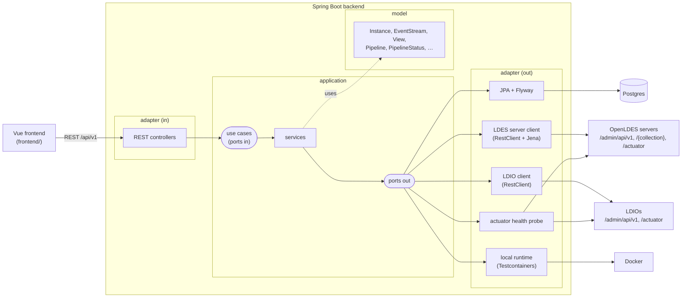

# LDES-admin architecture

LDES-admin monitors and manages OpenLDES servers and Linked Data Interaction Orchestrators (LDIO),
and offers a sandbox to design and try pipelines. See [README.md](README.md) for what it does; this
document describes how it is built.



## Hexagonal architecture

The backend follows the hexagonal architecture of
[Sven Woltmann's example](https://github.com/SvenWoltmann/hexagonal-architecture-java/tree/with-spring-boot):
every ring is a Maven module, so the compiler enforces that dependencies only point inwards.

| Module        | Contains                                                         | Depends on    | Frameworks                  |
|---------------|------------------------------------------------------------------|---------------|-----------------------------|
| `model`       | Domain model: records with their invariants and behaviour        | –             | none                        |
| `application` | Use cases (ports in), ports out, and the services implementing them | `model`     | none                        |
| `adapter`     | REST API, JPA persistence, LDES server/LDIO clients, local runtime | `application` | Spring, Jena, Testcontainers |
| `bootstrap`   | Spring Boot application, wiring, security, configuration         | `adapter`     | Spring Boot                 |

`DependencyRuleTest` (ArchUnit, in `bootstrap`) additionally checks what the modules cannot:
adapters don't depend on each other, inbound adapters only use use cases (never services),
outbound adapters only implement ports, and `model`/`application` stay free of Spring, Jakarta,
Jackson, Jena and Testcontainers.

The application services are plain Java classes marked with `@ApplicationService` (a plain
annotation of the application ring). `ApplicationServiceConfig` in `bootstrap` turns them into
beans by classpath scanning, so the application ring needs no Spring dependency.

### Packages

```
org.openldes.ldesadmin
├── model
│   ├── instance     Instance (aggregate root), InstanceId, InstanceType, InstanceOrigin, InstanceHealth
│   ├── rdf          RdfDocument, RdfFormat
│   ├── ldes         EventStream, View, Fragmentation, RetentionPolicy, DcatTarget, StreamStatistics
│   ├── ldio         Pipeline, InputDefinition, ComponentDefinition, DeployedPipeline, PipelineStatus, …
│   └── dashboard    DashboardOverview, LdesServerSummary, LdioSummary
├── application
│   ├── port.in      instance | ldes | ldio | dashboard     use case interfaces and their exceptions
│   ├── port.out     persistence | ldes | ldio | health | runtime, RemoteInstanceException
│   └── service      instance | ldes | ldio | dashboard     one service per use case
├── adapter
│   ├── in.rest      instance | ldes | ldio | dashboard, RestExceptionHandler (RFC 9457 problem details)
│   └── out          persistence.jpa | ldes | ldio | health | runtime | http (shared HTTP helpers)
└── bootstrap        LdesAdminApplication, ApplicationServiceConfig, SecurityConfig
```

## Domain model

* **Instance** – an LDES server or LDIO managed by LDES-admin. It is either *registered* (it runs
  somewhere; LDES-admin only knows its URL) or *local* (LDES-admin started it as a Docker container
  and stops it again). Any instance can be flagged as a *sandbox*. Instances are the only state
  LDES-admin stores itself.
* **EventStream / View / shape / DCAT** – the configuration of an LDES server. The admin API speaks
  RDF, so the definitions travel as `RdfDocument`s; the outbound adapter extracts the fields LDES-admin
  shows (collection, timestamp path, views, fragmentations, retention policies, page size).
* **Pipeline** – an LDIO pipeline: one input (with an optional adapter), a chain of transformers and
  one or more outputs, each a component name with its configuration. `DeployedPipeline` adds the
  status (`INIT`, `RUNNING`, `HALTED`, …); only running pipelines can be halted and only halted ones
  resumed.
* **Statistics** – members ingested, bucketised and paginated per stream and view (LDES server
  gauges), members in and out per pipeline (LDIO counters). The *backlog* of a stream is the number
  of members bucketised but not yet paginated in its slowest view.

## Use cases and REST API

Every use case is exposed by a controller under `/api/v1`; errors are problem details (`404` for
unknown instances, pipelines and remote resources, `409` for duplicates and impossible status
changes, `400` for invalid input or requests a server rejected, `502` when an instance cannot be
reached, `503` when a local instance cannot be started).

| Use case                          | Endpoints                                                                       |
|-----------------------------------|---------------------------------------------------------------------------------|
| Register / find / unregister instances | `GET, POST /ldes-servers`, `GET, DELETE /ldes-servers/{id}` (same for `/ldios`) |
| Start a local instance            | `POST /ldes-servers/local`, `POST /ldios/local`                                  |
| Check health                      | `GET /{ldes-servers,ldios}/{id}/health`                                          |
| Event streams                     | `GET, POST /ldes-servers/{id}/eventstreams`, `GET, DELETE …/eventstreams/{collection}` |
| Views                             | `GET, POST …/eventstreams/{collection}/views`, `GET, DELETE …/views/{view}`      |
| Shapes                            | `GET, PUT …/eventstreams/{collection}/shape`                                    |
| DCAT                              | `GET, POST /ldes-servers/{id}/dcat`, `PUT, DELETE …/dcat/{catalogId}`, `POST, PUT, DELETE` on `…/eventstreams/{collection}/dcat` and `…/views/{view}/dcat` |
| Ingest a member                   | `POST …/eventstreams/{collection}/members` (Turtle, JSON-LD, N-Quads, N-Triples) |
| Stream statistics                 | `GET /ldes-servers/{id}/statistics`                                              |
| Pipelines                         | `GET, POST /ldios/{id}/pipelines`, `GET, PUT, DELETE …/pipelines/{name}`         |
| Halt / resume                     | `GET …/pipelines/{name}/status`, `POST …/{name}/halt`, `POST …/{name}/resume`    |
| Component catalog, statistics     | `GET /ldios/{id}/catalog`, `GET /ldios/{id}/statistics`                          |
| Dashboard                         | `GET /dashboard`                                                                 |

LDIO has no update operation: updating a pipeline deletes it (waiting until LDIO has stopped it)
and creates it again.

## Outbound adapters

| Port                   | Adapter                       | Talks to                                                         |
|------------------------|-------------------------------|------------------------------------------------------------------|
| `InstanceRepository`   | `JpaInstanceRepository`       | Postgres; the schema is owned by Flyway (`adapter/src/main/resources/db/migration`), Hibernate only validates it |
| `LdesServerClient`     | `RestLdesServerClient`        | `/admin/api/v1/…` (Turtle, parsed with Apache Jena), `POST /{collection}`, `/actuator/prometheus` (`ldes_server_ingested_members_count`, `ldes_server_bucket_members_count`, `ldes_server_pagination_members_count`) |
| `LdioClient`           | `RestLdioClient`              | `/admin/api/v1/pipeline…`, `/admin/api/v1/catalog`, `/actuator/prometheus` (`ldio_data_in_total`, `ldio_data_out_total`) |
| `InstanceHealthProbe`  | `ActuatorHealthProbe`         | `/actuator/health`, falling back to the admin API                 |
| `LocalInstanceRuntime` | `DockerLocalInstanceRuntime`  | Docker, through the Testcontainers API: `openldes/ldes-server` with its own Postgres, or `openldes/ldi-orchestrator` |

HTTP errors are translated into a `RemoteInstanceException` with a reason (`NOT_FOUND`, `REJECTED`,
`UNAVAILABLE`), so no Spring type leaks into the application ring.

Assumptions worth knowing:

* An LDES server is reached on one base URL for its admin, ingest and fetch endpoints and its
  actuator (the default single-port setup). Statistics need `/actuator/prometheus` to be exposed.
* Local instances are for experimenting: Testcontainers removes them when LDES-admin stops. Their
  registrations remain and show up as down until they are removed.
* Starting a local instance blocks the request until the container is healthy (the first time
  includes pulling the image).

## Security

`SecurityConfig` leaves the API open by default, for local use. With
`ldes-admin.security.enabled=true` the API becomes an OAuth2 resource server that requires a JWT
(configure `spring.security.oauth2.resourceserver.jwt.issuer-uri`); `/actuator/health` stays public.

## Testing

| Level                    | Where                          | What                                                                  |
|--------------------------|--------------------------------|-----------------------------------------------------------------------|
| Unit                     | `model`, `application`         | Domain invariants; services against mocked ports (JUnit 6, AssertJ, Mockito) |
| Slice                    | `adapter`                      | Controllers with `@WebMvcTest` and `MockMvcTester`; HTTP clients against `MockRestServiceServer` |
| Integration (`*IT`)      | `adapter`                      | JPA + Flyway against Postgres; the LDES server and LDIO clients against real `openldes/ldes-server` and `openldes/ldi-orchestrator` containers, started by the local runtime adapter |
| Integration (`*IT`)      | `bootstrap`                    | The whole application over HTTP against Postgres; the secured API     |
| Architecture             | `bootstrap`                    | `DependencyRuleTest` (ArchUnit)                                       |
| Frontend unit            | `frontend/tests/unit`          | Pipeline graph, YAML and simulator, sandbox store, mock API, components (Jest) |
| Frontend end-to-end      | `frontend/cypress/e2e`         | Navigation, instance management, LDES server, sandbox (Cypress)       |

`./mvnw test` runs the unit, slice and architecture tests; `./mvnw verify` also runs the
integration tests, which need Docker.

## Frontend

Vue 3 with TypeScript, PrimeVue (Aura theme), Vue Flow, CodeMirror 6 and Chart.js, built with Vite
and pnpm.

```
frontend/src
├── domain       TypeScript types mirroring the web models of the REST API
├── api          LdesAdminApi (the port: one method per endpoint) and mock/ (in-memory adapter with sample data)
├── pipeline     catalog of LDIO components, graph ⇄ pipeline conversion and validation, YAML, simulator, templates
├── stores       Pinia: instances, sandbox, ui (dark mode)
├── components   layout, common, dashboard, instances, ldes, ldio, sandbox
└── views        one per route
```

The frontend does not call the backend yet: `api/index.ts` provides `MockLdesAdminApi`, which keeps
the sample data in memory and behaves like the backend, including its error responses. Connecting
the backend means writing an HTTP implementation of `LdesAdminApi`; the Vite dev server already
proxies `/api` to `localhost:8080`. Some screens show data the backend does not serve yet; those
methods are marked *planned* in `LdesAdminApi`: throughput history, an activity feed, the
background processes of a server, browsing the pages of a view, and the status of LDES client
pipelines.

### Sandbox

The sandbox draws a pipeline as a graph (Vue Flow): inputs, adapters, transformers and outputs are
dragged from the palette and connected top to bottom. The connection rules follow the LDIO
pipeline structure (an adapter only follows an input, transformers form a single chain, outputs end
the pipeline), and `graphToPipeline` turns the graph into an LDIO pipeline definition while
listing everything that keeps it from being valid. Selecting a component shows its part of the
pipeline as YAML, which is applied to the graph while typing. The whole pipeline can be edited as
YAML too, and deployed on an LDIO.

The simulator runs a member through the pipeline in the browser. RDF is parsed and serialised
for real (N3.js); each component approximates what LDIO does (adapters map JSON with a JSON-LD
context, the Version Object Creator and Materialiser rewrite subjects, GeoJSON becomes WKT, blank
nodes are skolemised, the change detection filter remembers members). SPARQL queries and RML
mappings are not evaluated. The result can be ingested in a sandbox LDES server.

## Next steps

* An HTTP implementation of `LdesAdminApi`, and authentication in the frontend (OIDC) for when the
  API is secured.
* Backend endpoints for the *planned* data above. Background processes and LDES client status are
  available from the servers (Spring Batch metadata, `GET /admin/api/v1/pipeline/ldes-client`);
  throughput and activity need LDES-admin to sample and keep history.
* Running sandbox pipelines on a real LDIO: deploy the pipeline on a sandbox LDIO with its outputs
  replaced by an `Ldio:HttpOut` to a capture endpoint of LDES-admin, post the member to the
  `Ldio:HttpIn` input, and return what arrives. Intermediate steps would need one deployment per
  prefix of the pipeline.
* Serving the built frontend from the Spring Boot application.
